# AI attribution canvas

A [GitHub Copilot app](https://docs.github.com/en/copilot/how-tos/github-copilot-app/agent-sessions)
canvas connecting people, AI usage, work and cost, with facts, estimates and
missing data clearly separated. It does not treat recorded usage as proof of
savings or business value.

It renders [the research](../../../docs/research/ai-telemetry-attribution.md) and
[the model spec](../../../docs/research/attribution-model.json), and adds live,
read-only coverage from this machine.

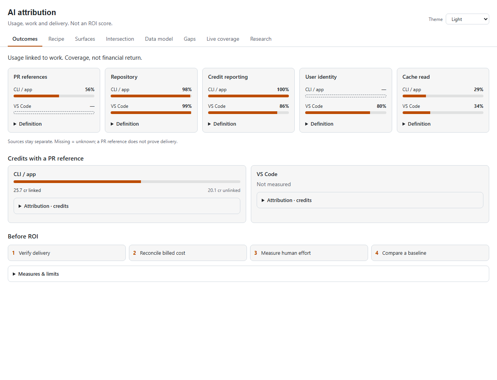

The screenshots in this document are generated by `npm run media:canvas` from
synthetic session and trace stores, with store discovery pointed at an empty
sandbox, so they never read live Copilot databases. Recipe verification in the
screenshots uses canned GitHub and Azure Boards answers, not the network.

## Views

Overview is the executive entry point: a mission statement and one hybrid map
of data sources, usage records, Recipe, delivery and the separate bill comparison.
The question about how much usage can be linked to work sits above the local
measurements, not above the mission. The map describes supported data flow,
not which sources are connected on a particular machine.

Labels use plain English; exact API fields and settings appear in setup or
technical details. Short summaries first; expand a cell, card or section for the full evidence.
Expanders support the keyboard and retain their state while the panel updates.
Missing values stay unknown, and source errors remain visible.
Every tab ends with a shared experimental-use warning: results may be incomplete
or inaccurate and must not be used alone for billing, savings claims or
individual performance decisions.

| Tab | Shows |
| --- | --- |
| Overview | Mission and at-a-glance map: sources → usage → Recipe → work/results, with bill comparison alongside; local measurements follow |
| Recipe | One delivery cycle per repository branch, from work item through AI work and commits to PR, review, merge and work-item closure, with optional GitHub and Azure Boards verification |
| Data sources | What each tool reports; choose all data types or those shared by every source |
| How it connects | Accounts, usage, work, results and bills, with clear explanations of the strength of each link |
| Missing data | Gaps, why they matter and what to do |
| Local usage | Recorded requests and credits by source, with token counts and breakdowns |
| Research | Short inline findings, limits and the cost-allocation explanation, with supporting source links |

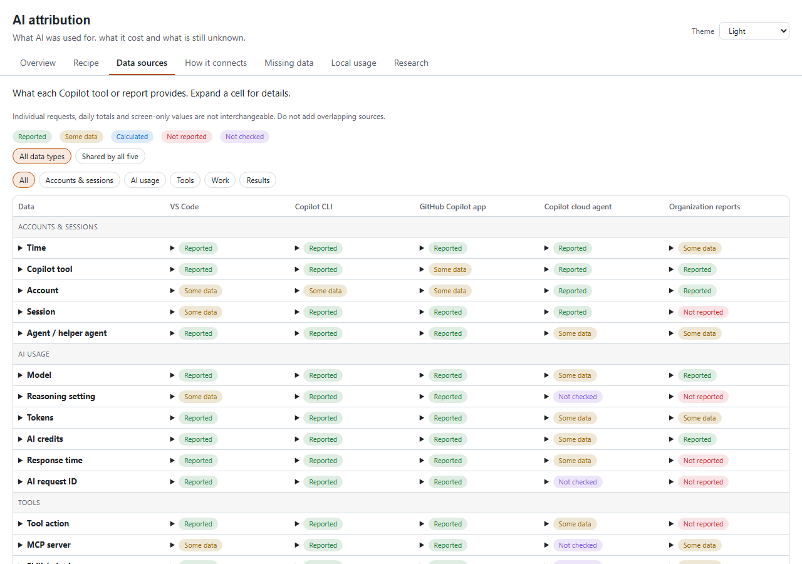

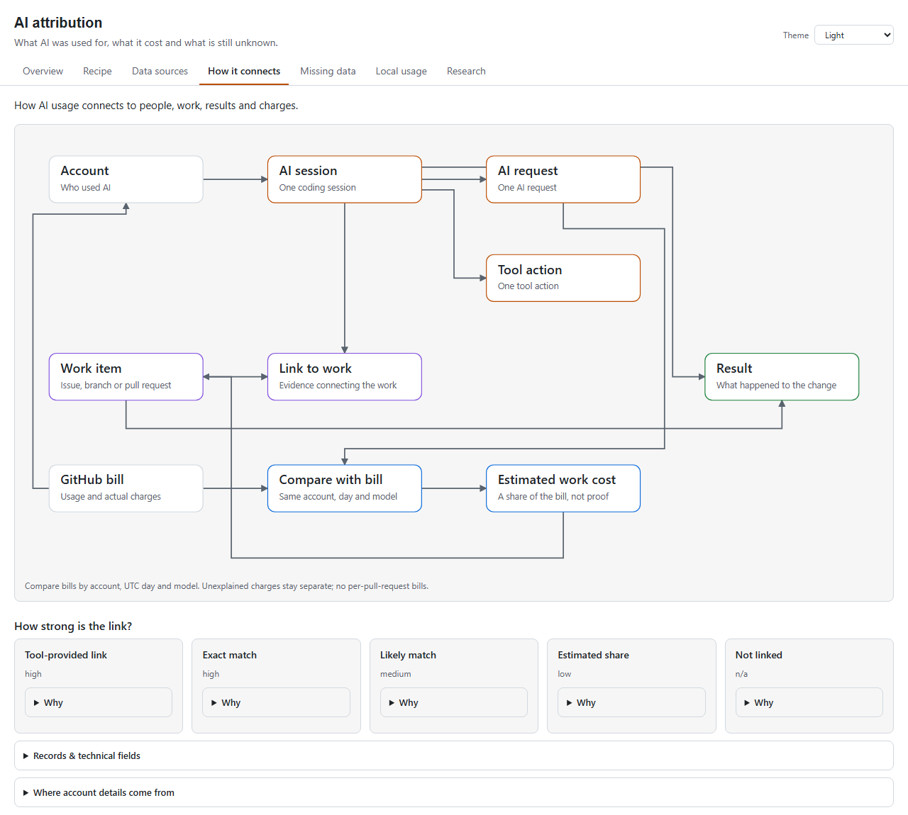

[Gaps preview](../../../docs/media/canvas-gaps.png) ·
[Research preview](../../../docs/media/canvas-research.png)

## Live coverage

| Source | Default location |
| --- | --- |
| Copilot CLI / app session store | `$COPILOT_HOME/session-store.db` (default `~/.copilot/`) |
| VS Code · Local harness | `globalStorage/github.copilot-chat/agent-traces.db` for Code and Code - Insiders |
| VS Code · Copilot Agent Host harness | `<userData>/agent-host/otel/agent-host-traces.db`, written only while `chat.agentHost.otel.dbSpanExporter.enabled` is on (VS Code 1.141+) |

The Copilot Agent Host harness store also holds Claude and Codex Agent Host traces; only
Copilot runtime traces (spans stamped with `github.copilot.*`) are counted. Its
credits are the per-turn `github.copilot.nano_aiu` on chat spans, never added to
the root invocation total.

Stores are opened read-only. If the file is locked, a temporary copy is read and
then deleted. Only aggregates are produced (counts, token and credit sums, and
model, agent, tool, repository and user names); prompt, response and tool content is
never read. Nothing leaves the machine unless you press **Check delivery** or **Read billing** on the Recipe
tab, and the two sources are shown side by side rather than summed.

### Reading coverage and token values

Repository and user context use the latest matching agent span **at or before**
each model call, through session, conversation, parent-session or trace keys.
Trace-only calls contribute to repository coverage and the breakdown but do
not create sessions. CLI/app repository and branch still come from the current
session row; that store does not version historical work context.

Token values are **reported subtotals**, with a per-field reporting-call count.
No reports displays `—`, not zero; a reported zero is still zero. Cache-read
share divides cache-read by input tokens only on calls reporting both valid
counts (cache cannot exceed input), and shows that paired-call coverage.
Partial reasoning or cache subtotals must not be treated as complete usage.

The surface matrix describes source capabilities, not everything ingested by
this canvas. Organisation reports include daily CLI/app tokens and partial
skill, plugin, custom-agent and MCP aggregates; MCP counts connections, not
tool calls. Task-completion events are self-reports, not correctness signals.
The **How it connects** tab carries the billing comparison rules: preserve
query scope, compare matching gross AI-credit consumption, and keep discounts,
final billed amounts and estimated work shares separate. Billing is read only
when you explicitly select **Read billing**.
Its **Where account details come from** expander distinguishes native identity/resource
signals, derived actor/device keys, configured organisational attributes and
external enrichment. Source capability does not mean that this local store
collected those values.

### Shared-surface filter

The **Data sources** tab's **Shared by all five** filter derives concepts available across VS Code, CLI, app,
cloud agent and organisation data from the model. Every cell must be native,
partial or derived; missing and unverified fields are excluded. Native across
all means directly emitted, not equivalent grain or comparable values.
Conditional across all includes opt-in, daily aggregates and panel-only data.
It does not join or sum sources.

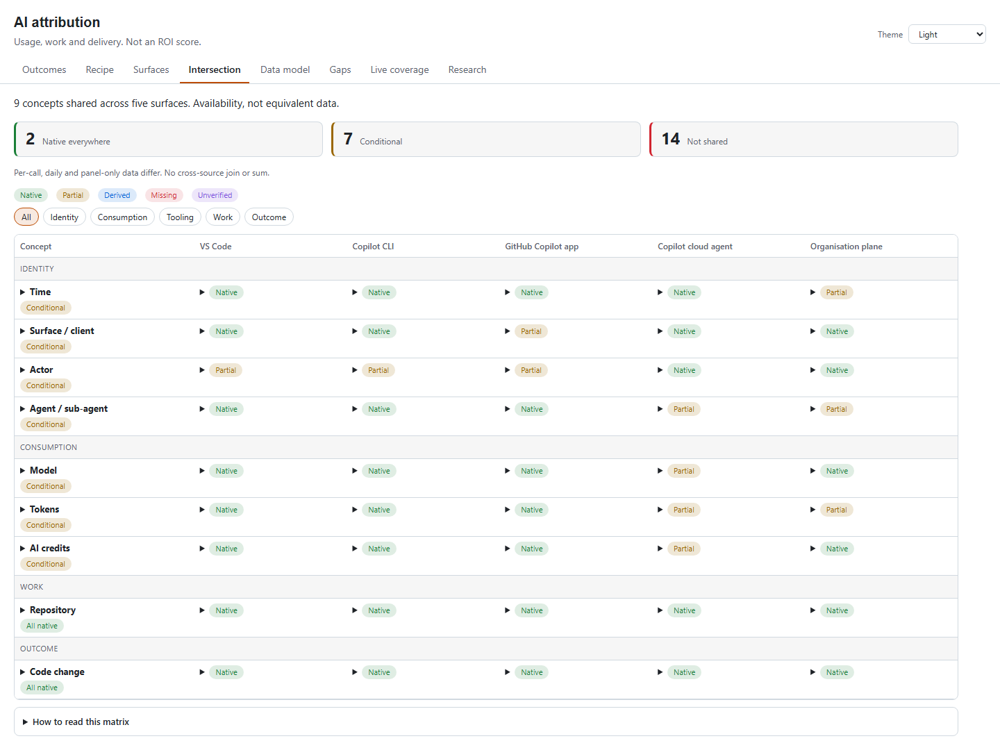

### Theme

**App / system** uses the documented host theme tokens and color mode when
available, otherwise the system light/dark preference. It follows live theme
changes. The **Theme** selector can explicitly choose Light or Dark for the
current page; reloading returns to App / system. No app-internal tokens are
required.

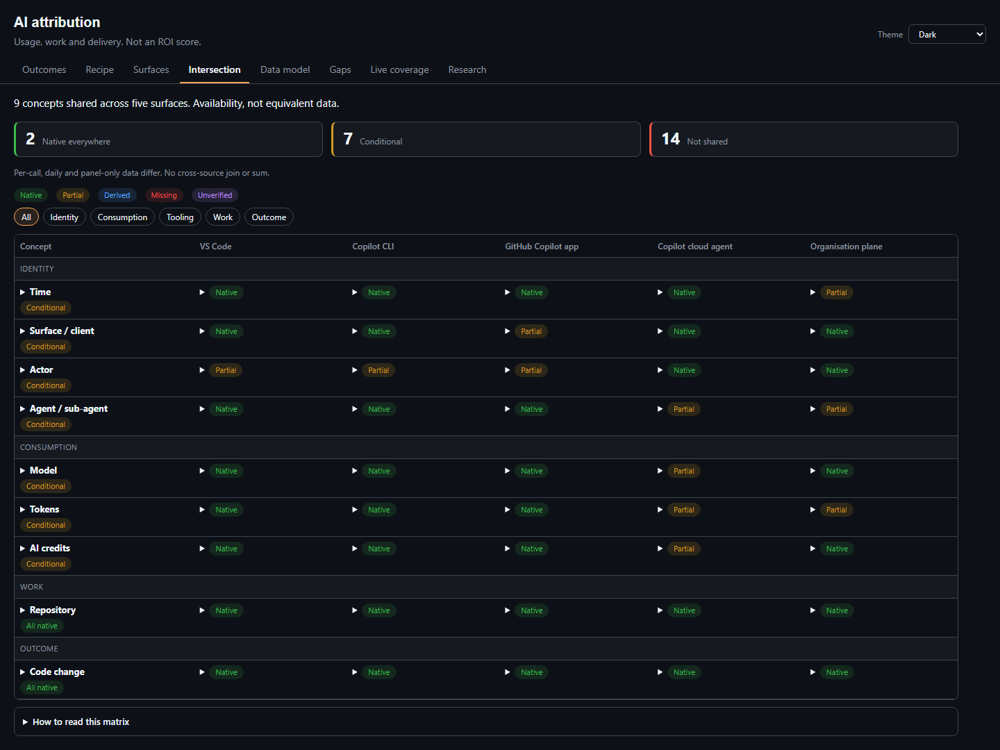

### User attribution

VS Code 1.140 can add the signed-in GitHub account to Copilot telemetry as
`user.name` on agent invocation spans
([identity capture](https://code.visualstudio.com/updates/v1_140#_capture-user-identity-in-opentelemetry),
`github.copilot.chat.otel.captureIdentity`, off by default). The VS Code source
resolves each model call's user from its own `user.name`, else from the latest
agent span at or before the call in the same chat session, conversation, parent
session or trace. It reports the share of credits attributed to a user
(**Linked to an account**) and a **By recorded account** breakdown. `process.user.name` and
`host.name` are resource attributes, which `agent-traces.db` does not store.
The CLI / app session store records no user, so its actor coverage is not
measured. This user name is the join key to organisation data keyed by
`user_login`; pseudonymise it before it leaves the machine.

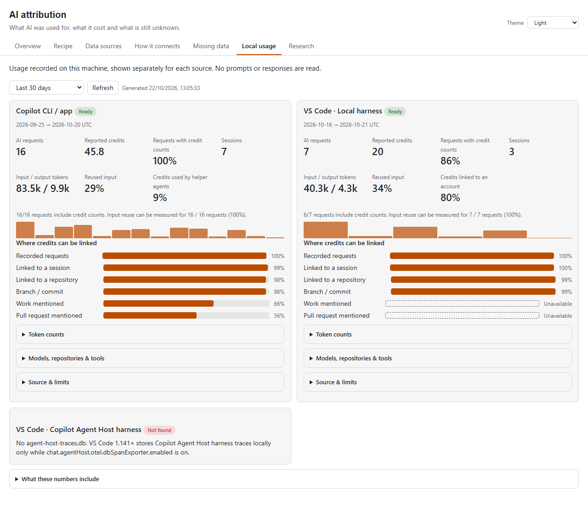

## Recipe

The **Recipe** tab follows one AI-assisted delivery cycle, from picking up a
work item to closing it. A cycle is one repository branch.

Start with **Setup & permissions**, then read **Lifecycle**, **Developer → work**,
**Reading the flow**, typical times, **Compare usage with the bill** and cycle timelines.
The guide explains all seven delivery handoffs and their assumptions, followed
by a separate billing handoff covering account/day/model matching, estimated
work costs and unexplained charges. Developer filters
affect the credit breakdown; lifecycle and timelines retain all work in the window.

| Phase | Steps | Local evidence | Verified evidence |
| --- | --- | --- | --- |
| Ingredients | Work item, branch | Branch convention, `session_refs` issue, session and span branch | GitHub issue state and type; Azure Boards type, state and dates |
| Method | AI work, commits | Sessions, model calls and reported credits per source; recorded commits; VS Code head commits moving | PR commit IDs and dates |
| Serve | Pull request, review, merge and close | `session_refs` PR | PR by number or head branch, reviews, merge, closing issues and work-item closure |

This README-only illustration uses the same synthetic cycle and billing response
as the canvas previews. The seven delivery steps run left to right, followed
visually by a separate mocked billing check and its estimated work cost.

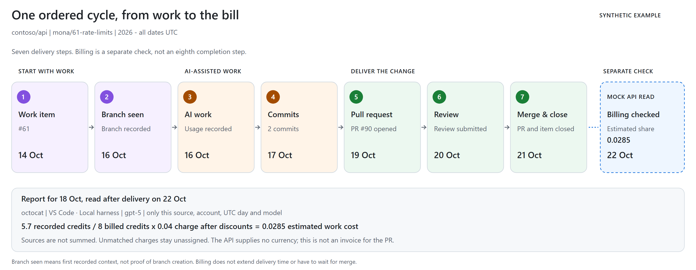

[Full canvas preview](../../../docs/media/canvas-recipe.png). The illustration is
not a live-canvas screenshot and does not trigger real API calls.

The **recipe strip** draws a band per step: the solid core counts cycles that
followed the recipe in order up to that step, the lighter band counts cycles
that have the step in any order, and the hatched band is unknown until verified.
Dotted tails show where cycles left the in-order recipe. Each step's evidence bar
splits **Verified** (GitHub or Azure Boards API), **Recorded** (an agent-recorded
reference, not ownership), **Convention** (branch name) and **Observed** (local
telemetry). Counts appear once in the strip; detailed credits appear once in
the developer table. Select a cycle to see its step-by-step card. Redundant
KPI cards, ingredient summaries and the duplicated surface matrix are removed.
The rightmost **Compare usage and bill** checkpoint is connected with a dashed
line: it follows delivery visually, but runs independently and is not an eighth
delivery funnel stage or a per-PR invoice.

Before verification, review, merge and closure are unknown rather than zero:

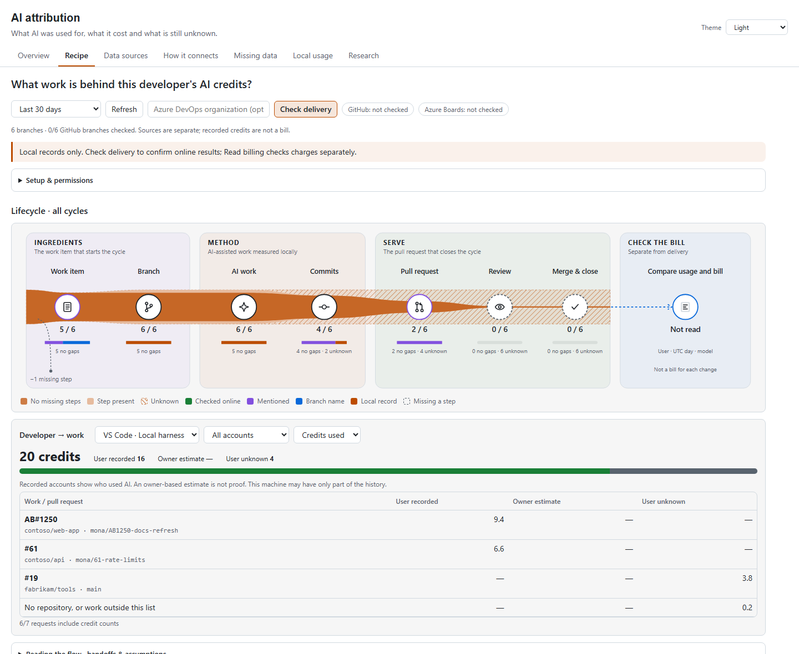

### Developer → work

Choose a **developer**, **source** and perspective:

- **Credits used:** the **User recorded**, **Owner estimate** and **User unknown**
  columns separate captured accounts, ownership-based estimates and unknown users. A measured
  consumer is never replaced by the assignee or PR author.
- **Work owned:** all contributors' usage on work associated with that
  developer, not their personal consumption.

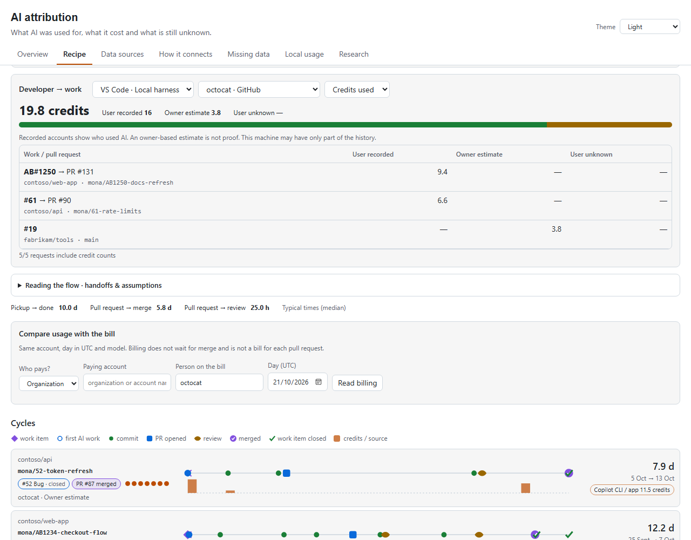

Each work group shows its credit breakdown once, even when it has several
linked items. No-repository usage and cycles outside the display cap remain
in the balance. Missing credit reports stay unknown. This is retained local
history for the selected window, not a complete organization or billing total.

Verify adds GitHub assignment history and the PR author, plus field-limited
Azure Boards assignment snapshots at first AI activity. Current and historical
assignees are separate roles. A sole historical owner / PR author can support
**inference**, never proof of who consumed AI throughout the cycle. Conflicting
owners remain unattributed; missing or truncated history is shown explicitly.

Azure Boards IDs are organization-qualified. **Link provider identities**
explicitly maps a Boards account to a GitHub login for this panel only.
Display names, emails and branch prefixes are never used to match people.
Links can also be supplied as `identityLinks` when opening the canvas, or set
through `set_recipe_identity_links`; they are not saved to disk.

### Branch convention and commit hook

The work item is the first token after the last slash of the branch name:

| Branch | Work item |
| --- | --- |
| `alex/AB123-add-recipe-tab` | Azure Boards work item 123 |
| `alex/123-add-recipe-tab` or `123-add-recipe-tab` | GitHub issue 123 in the same repository |
| `alex/add-recipe-tab` | None |

The opt-in [`hooks/commit-msg`](hooks/commit-msg) hook adds `Refs: AB#123` or
`Refs: #123` from the branch name when the message does not already reference
it, so Azure Boards and GitHub create their own links. It skips merges, detached
HEADs, empty messages and other branches, never blocks a commit, and needs Node
on `PATH`. Preserve existing hooks: copy/chain this hook if a hooksPath is already
configured. Otherwise, for this repository:

```sh
git config core.hooksPath .github/extensions/ai-attribution/hooks
```

Elsewhere, copy `hooks/commit-msg` into the repository's `.git/hooks/`. Set
`AI_ATTRIBUTION_HOOK=off` to skip it for one commit.

### Verification

**Check delivery** (`verify_recipe`) reads delivery metadata only when asked.
**Read billing** is a separate explicit network action.

- **GitHub.com** through the signed-in `gh` CLI. Each repository gets a GraphQL
  query, with values passed as variables, that finds the PR by recorded number or
  head branch. It reads PR state and dates, review states, commit IDs and dates,
  closing issues, issue type, author login and assignment events. Assignment
  history is bounded to 100 events per issue; incomplete history is not used
  to establish a past assignee. A branch name reused by an older PR does not match.
- **Azure Boards** through `_apis/wit/workitems` with fields limited to type,
  state, project, assignee and created/activated/resolved/closed dates. Field-limited
  `asOf` queries retrieve the assignee at first AI activity, not the current owner
  retroactively. Historical queries are capped at 60 cycles. State categories
  decide closure across processes. The organization comes from the tab, the
  `azureDevOpsOrg` input or `az devops configure --defaults organization=…`.
  The token comes from `AZURE_DEVOPS_EXT_PAT` or `az account get-access-token`,
  stays in memory and is never logged or returned.

Only repository, branch and PR, issue or work-item numbers plus first-activity
timestamps are sent. Account/assignment metadata is read; titles,
descriptions, commit messages, comments and email fields are never requested.
Inaccessible repositories, a missing `gh` or `az`, or an unconfigured organization
show as status chips. Credits stay per source, and reported credits per merged
PR are consumption, not cost.

### Setup & permissions

The Recipe section is the operational checklist for local stores and identity
capture, branch conventions, GitHub repository read access, Azure Boards
Work Items (Read) / project access and the paying account's billing permission.
It explains missing history, inferred owners, explicit provider identity links,
network opt-in and how to preserve existing commit hooks.

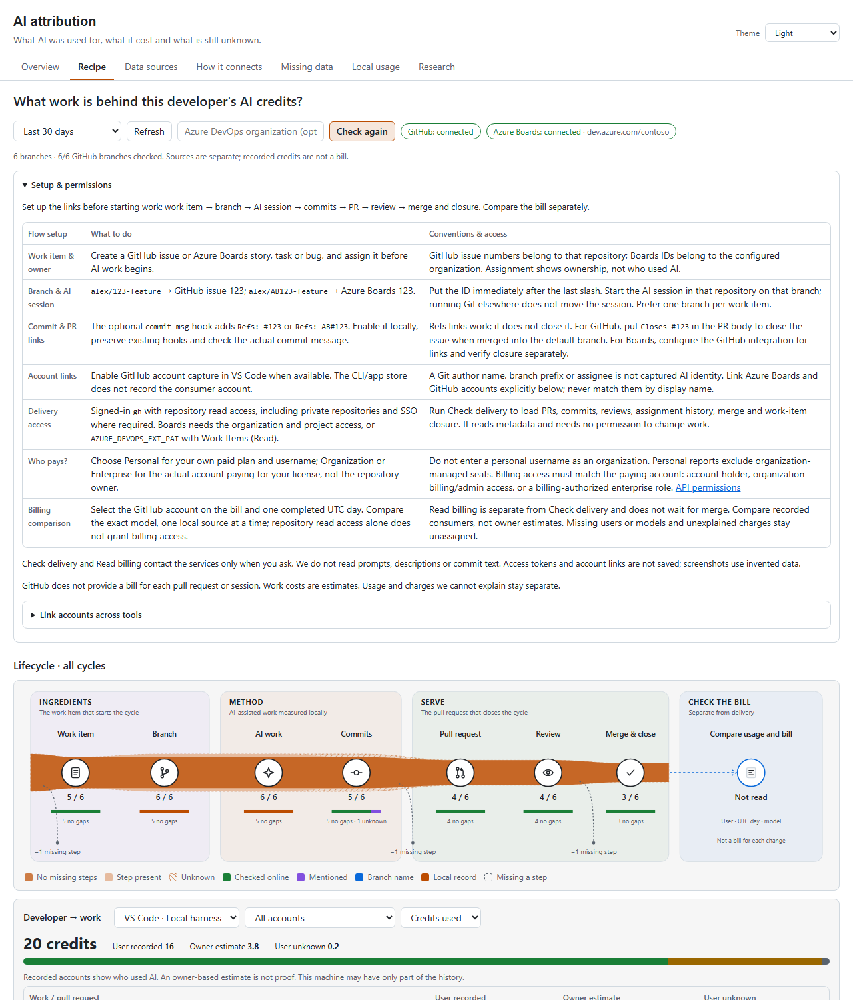

### Compare usage with the bill

Choose **organization**, **enterprise** or **personal**, the paying account, a
GitHub login and one completed **UTC day**. Read billing calls the corresponding
GitHub `settings/billing/ai_credit/usage` endpoint through `gh`, filtered to that
user, day and Copilot product. Repository read access alone does not grant billing
access. Personal reports exclude organization-managed seats.

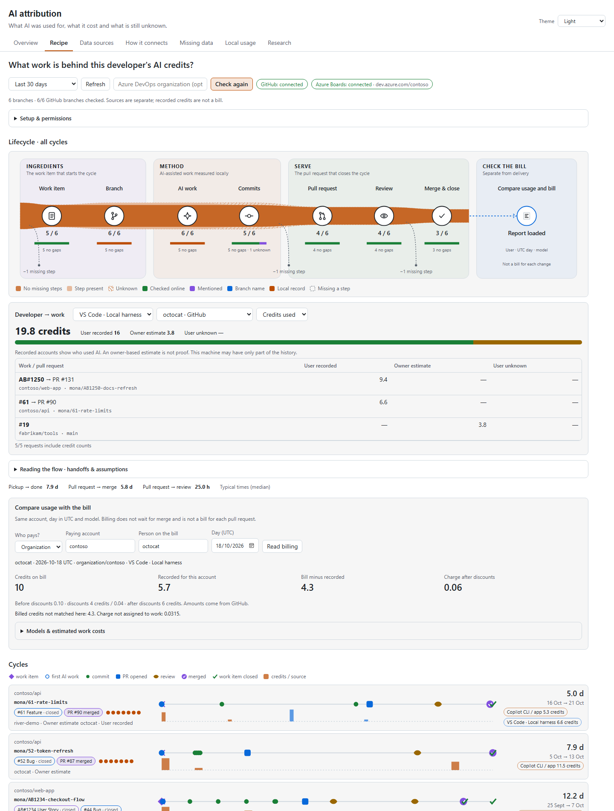

Compare gross credits to captured native-user credits per exact model and local
source. Gross, discounts and net quantities/amounts remain distinct. Unknown
consumers, unmatched model names and missing local history are not imputed.
Currency is not supplied by the endpoint; amounts are displayed as returned.

Billing has no PR/session IDs and accrues independently of merge. Work shares
are **estimated shares**: net amount times captured native work credits divided by
billed gross credits for that model. Unlinked work and uncaptured usage leave an
unallocated remainder. A model with more local credits than billed credits is
flagged and not allocated. Failed reads clear the previous report; nothing is
persisted and no token or raw failure body is returned.

Harness names are consistent across the canvas, status text and API source
labels. Their internal source IDs remain `traces` (Local harness) and `agentHost`
(Copilot Agent Host harness); database paths and settings are unchanged.

## Use

The app loads project extensions from `.github/extensions/`. Ask Copilot to open
the **AI attribution** canvas, or have the agent call:

```text
open_canvas({ canvasId: "ai-attribution", instanceId: "attribution", input: { view: "outcomes", windowDays: 30 } })
```

| Action | Input | Result |
| --- | --- | --- |
| `show_view` | `{ view }` | Switches tab |
| `refresh_coverage` | `{ windowDays? }` | Recomputes coverage; returns a summary |
| `get_coverage` | — | Full coverage object |
| `get_model` | `{ section? }` | Model spec or one section |
| `get_recipe` | `{ actorKey?, sourceId?, perspective? }` | Recipe and developer credit breakdown; perspective is `usage` or `ownership`; `actorKey: "__unknown"` selects unmatched usage/ownership |
| `verify_recipe` | `{ azureDevOpsOrg? }` | Verifies cycles with GitHub and Azure Boards; returns the Recipe summary |
| `set_recipe_identity_links` | `{ links: [{ boardsKey, githubLogin }] }` | Explicit cross-provider account links for this panel |
| `reconcile_recipe_billing` | `{ level, account, user, day }` | Explicit one-day AI-credit billing read and per-source reconciliation; no per-PR invoices |

Open input also accepts `sessionStorePath`, `tracesDbPath` and `agentHostTracesDbPath`
overrides, `azureDevOpsOrg`, and `identityLinks: [{ boardsKey, githubLogin }]`.
API view IDs remain `outcomes`, `recipe`, `surfaces`, `model`, `gaps`, `coverage`
and `research`; the display-name changes do not break callers.
Model schema 2 exposes descriptive `linkMethods`; estimated-cost rows use
`method: "estimated-share"`. The former research-only code system is removed.

## Layout

| File | Role |
| --- | --- |
| `extension.mjs` | Canvas declaration, actions and per-panel state |
| `lib/coverage.mjs` | Store discovery and coverage computation |
| `lib/recipe.mjs` | Recipe cycles, steps, evidence and KPIs (pure) |
| `lib/actors.mjs` | Provider-qualified identities, role attribution and per-source developer balances (pure) |
| `lib/billing.mjs` | Explicit GitHub billing reader, scope validation, per-source comparison and estimated work shares |
| `lib/convention.mjs` | Branch-name work-item convention |
| `lib/verify.mjs` | On-demand GitHub and Azure Boards verification |
| `hooks/commit-msg` | Opt-in hook adding the branch's work item to commit messages |
| `lib/tokenCoverage.cjs`, `lib/tokenCoverage.d.cts` | Shared paired-count and reporting-coverage logic; the declaration supplies the VS Code extension's type contract |
| `lib/server.mjs` | Loopback HTTP server, JSON API and server-sent events |
| `lib/model.mjs` | Loads the committed research files |
| `ui/format.mjs` | Shared display formatting and harness labels used by the canvas, source reports and status text |
| `ui/` | Static front end (no build step, no dependencies) |

After editing, reload extensions in the app. Tests live in
[`test/attributionCanvas.test.js`](../../../test/attributionCanvas.test.js) and
[`test/recipeCanvas.test.js`](../../../test/recipeCanvas.test.js) and
[`test/recipeActors.test.js`](../../../test/recipeActors.test.js) and
[`test/recipeBilling.test.js`](../../../test/recipeBilling.test.js).

## Reuse

This folder is committed, so the GitHub Copilot app loads the canvas for anyone
who opens this repository. To build another canvas from it:

| Part | Reuse as |
| --- | --- |
| `lib/server.mjs` | Generic per-panel loopback server: static files, JSON API, server-sent events, and Host/Origin checks against DNS rebinding and cross-site posts. Pass your own `uiDir` and `api`. |
| `ui/dom.js`, `ui/markdown.js` | Safe rendering: nodes built with text only, never HTML strings; links limited to `http(s)`. |
| `lib/coverage.mjs`, `lib/tokenCoverage.cjs` | Read-only local store access and shared token-reporting coverage; include both files when reusing the reader. |
| `extension.mjs` | Pattern for a canvas with an input schema, validated actions and cleanup on close. |

Copy the folder to `.github/extensions/<name>/` (shared with the repository) or
`~/.copilot/extensions/<name>/` (personal), then change the canvas `id`,
`displayName` and views. `lib/model.mjs` reads `docs/research/` relative to the
repository root; point `MODEL_PATH` and `RESEARCH_PATH` elsewhere when the
extension lives outside this repository.

To share without copying files, use **Share extension as gist…** in the app's
command palette and **Install extension from gist…** on the other side. The app
can also install straight from this folder's GitHub URL.
