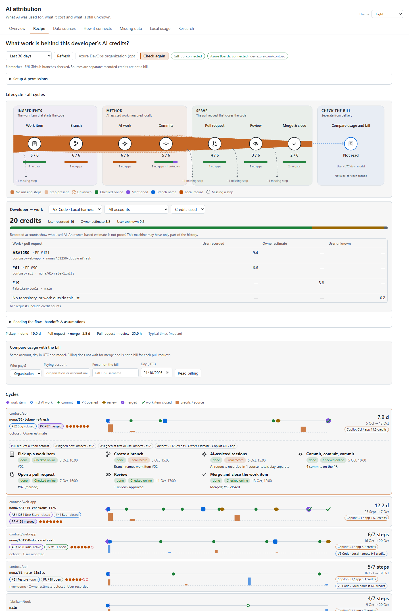

# AI attribution canvas

A [GitHub Copilot app](https://docs.github.com/en/copilot/how-tos/github-copilot-app/agent-sessions)
canvas for Data and Attribution Model. It examines what is
needed to measure ROI on AI-assisted development across VS Code, Copilot CLI,
the Copilot app and the cloud agent. Live local measurements show reported
usage and work-link coverage, not monetary ROI or proven value.

It renders [the research](../../../docs/research/ai-telemetry-attribution.md) and
[the model spec](../../../docs/research/attribution-model.json), and adds live,
read-only coverage from this machine.


The screenshots in this document are generated by `npm run media:canvas` from
synthetic session and trace stores, with store discovery pointed at an empty
sandbox, so they never read live Copilot databases. Recipe verification in the
screenshots uses canned GitHub and Azure Boards answers, not the network.

## Views

| Tab | Shows |
| --- | --- |
| Outcomes | ROI-readiness metrics, reported credits with/without a PR reference, and the cost, value and baseline inputs still needed |
| Recipe | One delivery cycle per repository branch, from work item through AI work and commits to PR, review, merge and work-item closure, with optional GitHub and Azure Boards verification |
| Surfaces | Concept × surface matrix with native / partial / missing / unverified fields |
| Intersection | Verified concepts available across all five surfaces, with native vs conditional availability and each source's grain/access caveats |
| Data model | Entities, relationships, attribution tiers and accounting invariants |
| Gaps | Gaps by impact, verification status and prior art |
| Live coverage | Per-source funnel, breakdowns by model, agent, reasoning effort, repository, user and tools |
| Research | The rendered research document and sources |


## Live coverage

| Source | Default location |
| --- | --- |
| Copilot CLI / app session store | `$COPILOT_HOME/session-store.db` (default `~/.copilot/`) |
| VS Code span store | `globalStorage/github.copilot-chat/agent-traces.db` for Code and Code - Insiders |
| VS Code Copilot harness span store | `<userData>/agent-host/otel/agent-host-traces.db`, written only while `chat.agentHost.otel.dbSpanExporter.enabled` is on (VS Code 1.141+) |

The Copilot harness store also holds Claude and Codex Agent Host traces; only
Copilot runtime traces (spans stamped with `github.copilot.*`) are counted. Its
credits are the per-turn `github.copilot.nano_aiu` on chat spans, never added to
the root invocation total.

Stores are opened read-only. If the file is locked, a temporary copy is read and
then deleted. Only aggregates are produced (counts, token and credit sums, and
model, agent, tool, repository and user names); prompt, response and tool content is
never read. Nothing leaves the machine unless you press **Verify** on the Recipe
tab, and the two sources are shown side by side rather than summed.

### Reading coverage and token values

Repository and user context use the latest matching agent span **at or before**
each model call, through session, conversation, parent-session or trace keys.
Trace-only calls contribute to repository coverage and the breakdown but do
not create sessions. CLI/app repository and branch still come from the current
session row; that store does not version historical work context.

Token values are **reported subtotals**, with a per-field reporting-call count.
No reports displays `—`, not zero; a reported zero is still zero. Cache-read
share divides cache-read by input tokens only on calls reporting both valid
counts (cache cannot exceed input), and shows that paired-call coverage.
Partial reasoning or cache subtotals must not be treated as complete usage.

The surface matrix describes source capabilities, not everything ingested by
this canvas. Organisation reports include daily CLI/app tokens and partial
skill, plugin, custom-agent and MCP aggregates; MCP counts connections, not
tool calls. Task-completion events are self-reports, not correctness signals.
The **Data model** tab carries the billing reconciliation contract: preserve
query scope, compare matching gross AI-credit consumption, and keep discounts,
net billed amounts and T3 allocations separate. Billing is not connected here.
Its **Actor field provenance** table distinguishes native identity/resource
signals, derived actor/device keys, configured organisational attributes and
external enrichment. Source capability does not mean that this local store
collected those values.

### Intersection

The **Intersection** tab derives concepts available across VS Code, CLI, app,
cloud agent and organisation data from the model. Every cell must be native,
partial or derived; missing and unverified fields are excluded. Native across
all means directly emitted, not equivalent grain or comparable values.
Conditional across all includes opt-in, daily aggregates and panel-only data.
It does not join or sum sources.


### Theme

**App / system** uses the documented host theme tokens and color mode when
available, otherwise the system light/dark preference. It follows live theme
changes. The **Theme** selector can explicitly choose Light or Dark for the
current page; reloading returns to App / system. No app-internal tokens are
required.


### User attribution

VS Code 1.140 can add the signed-in GitHub account to Copilot telemetry as
`user.name` on agent invocation spans
([identity capture](https://code.visualstudio.com/updates/v1_140#_capture-user-identity-in-opentelemetry),
`github.copilot.chat.otel.captureIdentity`, off by default). The VS Code source
resolves each model call's user from its own `user.name`, else from the latest
agent span at or before the call in the same chat session, conversation, parent
session or trace. It reports the share of credits attributed to a user
(**Actor coverage**) and a **By user** breakdown. `process.user.name` and
`host.name` are resource attributes, which `agent-traces.db` does not store.
The CLI / app session store records no user, so its actor coverage is not
measured. This user name is the join key to organisation data keyed by
`user_login`; pseudonymise it before it leaves the machine.


## Recipe

The **Recipe** tab follows one AI-assisted delivery cycle, from picking up a
work item to closing it. A cycle is one repository branch.

| Phase | Steps | Local evidence | Verified evidence |
| --- | --- | --- | --- |
| Ingredients | Work item, branch | Branch convention, `session_refs` issue, session and span branch | GitHub issue state and type; Azure Boards type, state and dates |
| Method | AI work, commits | Sessions, model calls and reported credits per source; recorded commits; VS Code head commits moving | PR commit IDs and dates |
| Serve | Pull request, review, merge and close | `session_refs` PR | PR by number or head branch, reviews, merge, closing issues and work-item closure |



The **recipe strip** draws a band per step: the solid core counts cycles that
followed the recipe in order up to that step, the lighter band counts cycles
that have the step in any order, and the hatched band is unknown until verified.
Dotted tails show where cycles left the in-order recipe. Each step's evidence bar
splits **Verified** (GitHub or Azure Boards API), **Recorded** (an agent-recorded
reference, not ownership), **Convention** (branch name) and **Observed** (local
telemetry). Below it are serve KPIs (PRs opened, reviewed, merged and closed,
and median lead times), the branch-convention gauge, ingredients by work-item
type, and one timeline per cycle. Select a cycle to see its step-by-step card.

Before verification, review, merge and closure are unknown rather than zero:


### Branch convention and commit hook

The work item is the first token after the last slash of the branch name:

| Branch | Work item |
| --- | --- |
| `alex/AB123-add-recipe-tab` | Azure Boards work item 123 |
| `alex/123-add-recipe-tab` or `123-add-recipe-tab` | GitHub issue 123 in the same repository |
| `alex/add-recipe-tab` | None |

The opt-in [`hooks/commit-msg`](hooks/commit-msg) hook adds `Refs: AB#123` or
`Refs: #123` from the branch name when the message does not already reference
it, so Azure Boards and GitHub create their own links. It skips merges, detached
HEADs, empty messages and other branches, never blocks a commit, and needs Node
on `PATH`. For this repository:

```sh
git config core.hooksPath .github/extensions/ai-attribution/hooks
```

Elsewhere, copy `hooks/commit-msg` into the repository's `.git/hooks/`. Set
`AI_ATTRIBUTION_HOOK=off` to skip it for one commit.

### Verification

**Verify with GitHub & Azure Boards** (or the `verify_recipe` action) is the only
network step, and runs only when asked:

- **GitHub.com** through the signed-in `gh` CLI. Each repository gets a GraphQL
  query, with values passed as variables, that finds the PR by recorded number or
  head branch. It reads PR state and dates, review states, commit IDs and dates,
  closing issues and issue type. A branch name reused by an older PR does not
  match.
- **Azure Boards** through `_apis/wit/workitems` with fields limited to type,
  state, project and created/activated/resolved/closed dates. State categories
  decide closure across processes. The organization comes from the tab, the
  `azureDevOpsOrg` input or `az devops configure --defaults organization=…`.
  The token comes from `AZURE_DEVOPS_EXT_PAT` or `az account get-access-token`,
  stays in memory and is never logged or returned.

Only repository, branch and PR, issue or work-item numbers are sent. Titles,
descriptions, commit messages, comments and logins are never requested.
Inaccessible repositories, a missing `gh` or `az`, or an unconfigured organization
show as status chips. Credits stay per source, and reported credits per merged
PR are consumption, not cost.

## Use

The app loads project extensions from `.github/extensions/`. Ask Copilot to open
the **AI attribution** canvas, or have the agent call:

```text
open_canvas({ canvasId: "ai-attribution", instanceId: "attribution", input: { view: "outcomes", windowDays: 30 } })
```

| Action | Input | Result |
| --- | --- | --- |
| `show_view` | `{ view }` | Switches tab |
| `refresh_coverage` | `{ windowDays? }` | Recomputes coverage; returns a summary |
| `get_coverage` | — | Full coverage object |
| `get_model` | `{ section? }` | Model spec or one section |
| `get_recipe` | — | Recipe stations, KPIs, convention adherence and latest cycles |
| `verify_recipe` | `{ azureDevOpsOrg? }` | Verifies cycles with GitHub and Azure Boards; returns the Recipe summary |

Open input also accepts `sessionStorePath`, `tracesDbPath` and `agentHostTracesDbPath` overrides, and `azureDevOpsOrg`.

## Layout

| File | Role |
| --- | --- |
| `extension.mjs` | Canvas declaration, actions and per-panel state |
| `lib/coverage.mjs` | Store discovery and coverage computation |
| `lib/recipe.mjs` | Recipe cycles, steps, evidence and KPIs (pure) |
| `lib/convention.mjs` | Branch-name work-item convention |
| `lib/verify.mjs` | On-demand GitHub and Azure Boards verification |
| `hooks/commit-msg` | Opt-in hook adding the branch's work item to commit messages |
| `lib/tokenCoverage.cjs`, `lib/tokenCoverage.d.cts` | Shared paired-count and reporting-coverage logic; the declaration supplies the VS Code extension's type contract |
| `lib/server.mjs` | Loopback HTTP server, JSON API and server-sent events |
| `lib/model.mjs` | Loads the committed research files |
| `ui/` | Static front end (no build step, no dependencies) |

After editing, reload extensions in the app. Tests live in
[`test/attributionCanvas.test.js`](../../../test/attributionCanvas.test.js) and
[`test/recipeCanvas.test.js`](../../../test/recipeCanvas.test.js).

## Reuse

This folder is committed, so the GitHub Copilot app loads the canvas for anyone
who opens this repository. To build another canvas from it:

| Part | Reuse as |
| --- | --- |
| `lib/server.mjs` | Generic per-panel loopback server: static files, JSON API, server-sent events, and Host/Origin checks against DNS rebinding and cross-site posts. Pass your own `uiDir` and `api`. |
| `ui/dom.js`, `ui/markdown.js` | Safe rendering: nodes built with text only, never HTML strings; links limited to `http(s)`. |
| `lib/coverage.mjs`, `lib/tokenCoverage.cjs` | Read-only local store access and shared token-reporting coverage; include both files when reusing the reader. |
| `extension.mjs` | Pattern for a canvas with an input schema, validated actions and cleanup on close. |

Copy the folder to `.github/extensions/<name>/` (shared with the repository) or
`~/.copilot/extensions/<name>/` (personal), then change the canvas `id`,
`displayName` and views. `lib/model.mjs` reads `docs/research/` relative to the
repository root; point `MODEL_PATH` and `RESEARCH_PATH` elsewhere when the
extension lives outside this repository.

To share without copying files, use **Share extension as gist…** in the app's
command palette and **Install extension from gist…** on the other side. The app
can also install straight from this folder's GitHub URL.
